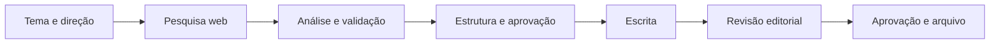

<div align="center">

# 🎬 Máquina de Roteiros

**Seu estúdio de produção editorial com IA, organizado por canal.**

Da pesquisa ao roteiro aprovado: reúna skills, documentos, motores de IA e histórico de produção em uma interface web que roda na sua máquina.


[Começar](#-comece-em-poucos-passos) · [Recursos](#-o-que-você-pode-fazer) · [Motores de IA](#-escolha-a-ia-de-cada-etapa) · [Privacidade](#-seus-dados)

</div>

---

## ✨ O que você pode fazer

| Recurso | Como ajuda na produção |
|---|---|
| **Projetos por canal** | Mantenha identidade, idioma, instruções, documentos e histórico de cada canal no seu próprio projeto. |
| **Skills em ZIP ou `.skill`** | Importe a skill escritora com sua estrutura de pastas e referências. |
| **Documentos do projeto** | Organize planejamento, exemplos aprovados, mapa de concorrência e registro de produção junto da skill. |
| **Fluxos por etapas** | Separe pesquisa, planejamento, escrita e revisão, com pontos de aprovação. |
| **IA por função** | Escolha provedor, modelo e esforço nas etapas que oferecem configuração de motor. |
| **Pesquisa web** | Colete fontes com DeepSeek Search ou OpenAI Web Search para as etapas seguintes. |
| **Revisão editorial** | Avalie estrutura, consistência, clareza, ritmo, linguagem e verossimilhança. |
| **Prompts para cenas** | Transforme roteiro e SRT em prompts para Veo/Flow, com estilo, câmera e planejamento visual. |
| **Fila e retomada** | Acompanhe tarefas, preserve resultados parciais e retome a partir das etapas salvas. |
| **Arquivo de produção** | Finalize roteiros com pastas por canal, histórico e atualização do registro de produção. |

## 🚀 Comece em poucos passos

### 1. Prepare o ambiente

Tenha **Node.js 24.15 ou superior** instalado. Para usar os motores de IA, você também precisa de uma chave de API ou de um CLI compatível instalado e autenticado.

O aplicativo usa bibliotecas nativas do Node.js: **não é necessário executar `npm install`**. Os verificadores específicos do perfil Staff Ride exigem Python disponível no ambiente; o servidor e a interface não dependem dele.

### 2. Baixe o projeto

Baixe o ZIP pelo botão **Code → Download ZIP** do GitHub e extraia, ou clone:

```powershell
git clone https://github.com/jcppaula/maquina-de-roteiros.git
cd maquina-de-roteiros
```

### 3. Abra o Estúdio

No Windows, dê dois cliques em **`Iniciar Estudio.bat`**. Ele inicia o servidor e abre o navegador. Se o Estúdio já estiver disponível, abre a instância existente.

Você também pode iniciar pelo terminal, dentro da pasta do projeto:

```powershell
npm.cmd start
```

Acesse **[http://127.0.0.1:3210](http://127.0.0.1:3210)**. Mantenha a janela do servidor aberta durante o uso e pressione **Ctrl+C** nela para encerrar.

### 4. Configure sua primeira IA

Em **Configurações**:

1. Preencha a chave de API ou configure o CLI do provedor.
2. Use **Testar conexão** e **Listar modelos**.
3. Escolha um modelo e, quando disponível, o esforço padrão.
4. **Salve** para usar a configuração nas gerações.

Os testes usam os valores preenchidos, mas não salvam a configuração automaticamente. Na lateral, a bolinha **verde** indica uma verificação bem-sucedida; **vermelha** indica falha ou conexão ainda não verificada. Esse estado não garante saldo ou acesso a qualquer modelo.

## 🧠 Escolha a IA de cada etapa

Use o motor adequado para cada tarefa e ajuste o fluxo ao seu modo de trabalhar.

| Motor | Conexão |
|---|---|
| **OpenAI** | Chave de API; geração de texto e serviço de pesquisa web. |
| **Google Gemini** | Chave de API para geração de texto. |
| **DeepSeek** | Chave de API; geração de texto e DeepSeek Search. |
| **Claude** | CLI instalado e autenticado na máquina. |
| **Codex** | CLI instalado e autenticado na máquina. |
| **Antigravity / AGY** | CLI instalado, autenticado e com acesso aos modelos da conta. |

O assistente do projeto e as etapas editoriais podem ter configurações independentes de **provedor, modelo e esforço**. Onde houver opção de herdar, o motor vem da tarefa ou dos padrões salvos. Modelos e níveis de esforço dependem do provedor e da conta; você também pode informar um ID manualmente.

Por exemplo: a coleta web pode usar DeepSeek Search, a análise da pesquisa pode usar Gemini via AGY, a escrita pode usar Claude e a revisão pode usar DeepSeek.

> **Pesquisa e geração têm configurações próprias.** Nesta versão, a coleta web integrada usa DeepSeek Search ou OpenAI Web Search. Selecionar AGY em uma etapa editorial não ativa sua navegação nativa. A validação recebe o material coletado e não realiza novas buscas autônomas.

## 📁 Um projeto para cada canal

Em **Meus canais**, cadastre o canal e suas características. Depois, em **Projetos dos canais**, monte seu ambiente editorial:

1. Envie o pacote ZIP/`.skill` com o `SKILL.md` e os arquivos de apoio.
2. Selecione a skill escritora principal.
3. Envie os documentos externos que ela utiliza.
4. Confira os documentos solicitados, as referências e os avisos.
5. Configure as etapas e seus motores de IA.

O pacote aparece como uma árvore de arquivos, preservando pastas como `assets/`, `references/` e `scripts/`. Os documentos externos aparecem em espaços identificados a partir das necessidades da skill.

O **assistente de configuração** faz uma inspeção local das dependências e oferece análise opcional por IA. Você revisa a proposta antes de aplicá-la. A presença de um arquivo não certifica que seu conteúdo esteja completo. Enviar uma skill não instala serviços nem executa automaticamente seus scripts; o perfil Staff Ride possui verificadores específicos previamente integrados.

As revisões do projeto ficam registradas. As tarefas guardam o contexto e a identificação dos documentos usados; editar o projeto depois não altera o contexto de uma geração já iniciada.

## ✍️ Do tema ao roteiro final

O fluxo pode ser adaptado ao projeto. Um processo editorial típico é:



### Crie a tarefa

Escolha o canal, informe o tema e acrescente duração, premissa, direção criativa e orientações. Para canais com projeto ativo, use **Fluxo da skill do canal**. O botão de geração do projeto já seleciona esse modo.

Para roteiros sem projeto, há modos direto e combinações de planejamento, escrita, conferência factual e auditoria. É possível informar um tema por linha para enfileirar vários roteiros.

### Acompanhe e aprove

Na **Fila e histórico**, acompanhe o progresso e consulte planos, pesquisas, revisões e resultados parciais. Nos pontos de aprovação, revise os artefatos antes de continuar.

As revisões editoriais apontam problemas com trechos, localização, gravidade e correções necessárias, além de um veredito com nota. A avaliação editorial complementa a verificação das fontes; não certifica a veracidade do roteiro.

Tarefas interrompidas podem ser retomadas com reaproveitamento das etapas concluídas e salvas. Uma chamada que falhou antes de salvar o resultado pode precisar ser repetida. A fila permite até **três tarefas simultâneas**, conforme a configuração.

### Finalize e organize

Quando a finalização estiver habilitada, informe o número do vídeo e revise a prévia de arquivamento. **Aprovar e finalizar** pode:

- Salvar o roteiro no banco local.
- Arquivar o material no histórico do canal.
- Atualizar a cópia do registro de produção dentro do projeto.
- Exportar roteiro, narração, etapas, fontes e relatórios disponíveis para uma pasta própria.

A organização de produção segue este formato:

```text
data/
├── store.json
├── projects/
│   └── revisões dos projetos
└── producao/
    └── nome-do-canal-ID/
        └── numero-titulo-ID/
            ├── roteiro.md
            ├── narracao.txt
            └── etapas/
```

A atualização do registro usa o número do vídeo e preserva os dados existentes de publicação, link, visualizações e observações. Os arquivos originais enviados permanecem intactos: o Estúdio trabalha com as cópias do projeto.

## 🎥 Prompts para Veo / Flow

Em **Cenas Veo 3**, forneça o roteiro e seu arquivo SRT. Escolha estilo visual, movimento de câmera, motor de planejamento e configuração dos lotes.

O Estúdio prepara um planejamento visual e gera **um prompt em inglês por bloco do SRT**, usando contexto entre lotes para orientar a continuidade. Os tempos do SRT são preservados nos blocos, e a saída passa por validação de numeração, quantidade e ordem. Também é possível gerar capítulos.

Esta função produz **prompts**, não vídeos. A aplicação não envia os prompts automaticamente ao Google Flow, e a validação de formato não garante continuidade visual perfeita no vídeo gerado.

## 🔒 Seus dados

O servidor roda em **`127.0.0.1`**, acessível localmente. Canais, documentos, tarefas e configurações ficam na pasta `data/` da sua instalação.

- **Local na sua máquina:** interface, armazenamento e organização dos projetos.
- **Enviado aos provedores:** os textos e documentos necessários às chamadas de IA e as consultas ao serviço de pesquisa escolhido. Essas chamadas exigem conexão e podem consumir créditos ou limites da conta.
- **Credenciais:** chaves salvas pela interface ficam em texto em `data/store.json` e podem estar no backup local. Essa pasta deve ser protegida.
- **Git:** `data/`, `.env`, capturas e diagnósticos locais estão excluídos da publicação pelo `.gitignore`. O repositório não inclui suas credenciais ou documentos particulares.
- **Backup pela interface:** exporta canais, roteiros, projetos e tarefas, sem as configurações dos provedores. Os textos exportados podem conter material privado; revise-os antes de compartilhar.

Para evitar salvar chaves no banco local, você pode usar as variáveis `OPENAI_API_KEY`, `GEMINI_API_KEY` e `DEEPSEEK_API_KEY`. Arquivos `.env` não são carregados automaticamente pelo comando padrão de início.

Para preservar também as pastas exportadas de produção, copie a pasta `data/` com o servidor encerrado. Essa cópia completa inclui as configurações e as chaves salvas.

## 🛠️ Desenvolvimento

O projeto usa **Node.js e módulos nativos**, com interface em HTML, CSS e JavaScript.

| Pasta | Conteúdo |
|---|---|
| `lib/` | Integrações de IA, projetos, fluxos, fila, armazenamento e exportação. |
| `public/` | Interface web. |
| `library/` | Biblioteca de estilos e movimentos de câmera. |
| `reference/prompts/` | Templates usados nas etapas de geração. |
| `tests/` | Testes automatizados e regressões. |
| `data/` | Dados locais criados durante o uso; fora do Git. |

Execute os testes com:

```powershell
npm.cmd test
```

Os testes usam serviços locais simulados e mocks, sem consumir créditos de geração. Cobrem integrações, persistência, projetos, aprovação, exportação, proteção de credenciais, SRT e regressões da interface.

Para usar outra porta pelo PowerShell:

```powershell
$env:PORT = 3211
node server.mjs
```

## ❓ Dúvidas frequentes

**Preciso instalar todas as IAs?**

Configure somente os provedores que pretende usar. Serviços via API precisam de chave; integrações via CLI precisam da ferramenta instalada e autenticada.

**O aplicativo funciona sem internet?**

A interface e os dados ficam locais. Pesquisa web e geração pelos provedores dependem de conexão.

**Subir a skill já deixa tudo pronto?**

O pacote fornece as instruções e referências internas. Complete os documentos externos solicitados, escolha os motores e confira os avisos antes de gerar.

**Posso mudar a IA de escrita sem perder a pesquisa?**

Sim. O material coletado é usado como contexto nas etapas seguintes, que podem usar motores diferentes.

**Se fechar o programa, perco a tarefa?**

As etapas já salvas permanecem disponíveis. Ao reiniciar, tarefas interrompidas podem ser retomadas pela fila. Uma chamada ainda em andamento pode não ter seu resultado salvo, mesmo que o provedor a tenha processado.

**Ele publica vídeos ou gera áudio?**

O foco atual é pesquisa, roteiros, revisão, organização editorial e prompts visuais. A publicação dos vídeos, a síntese de voz e a renderização ficam nas ferramentas que você escolher.
